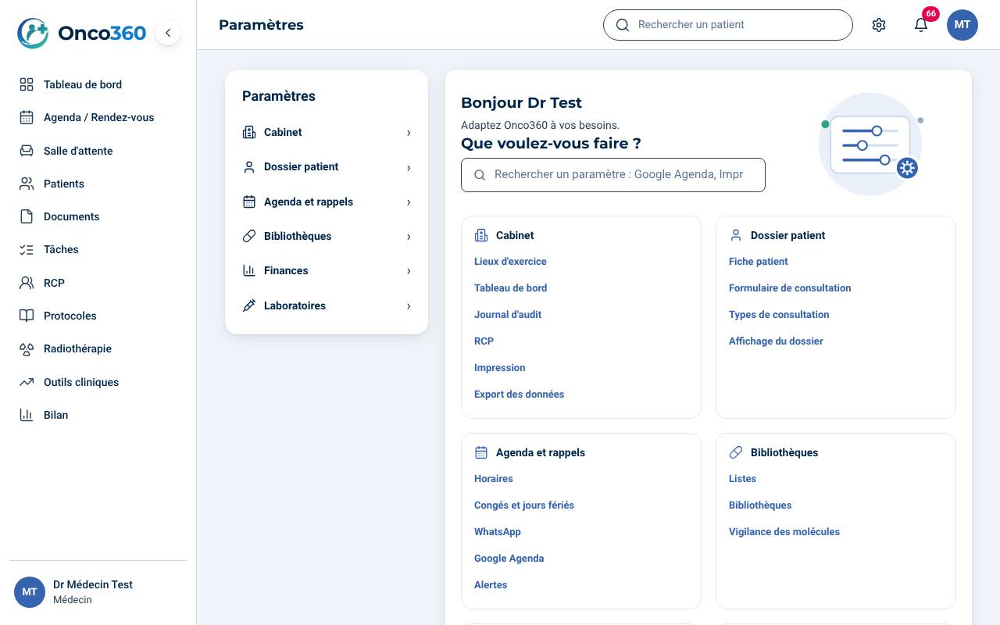
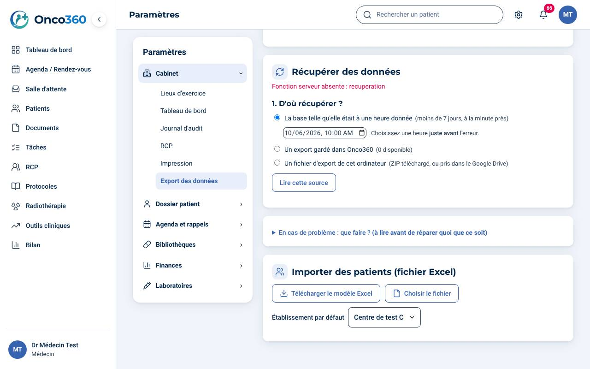
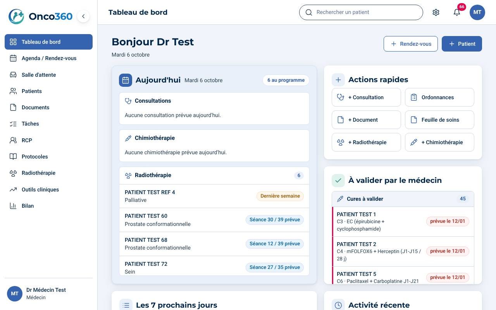
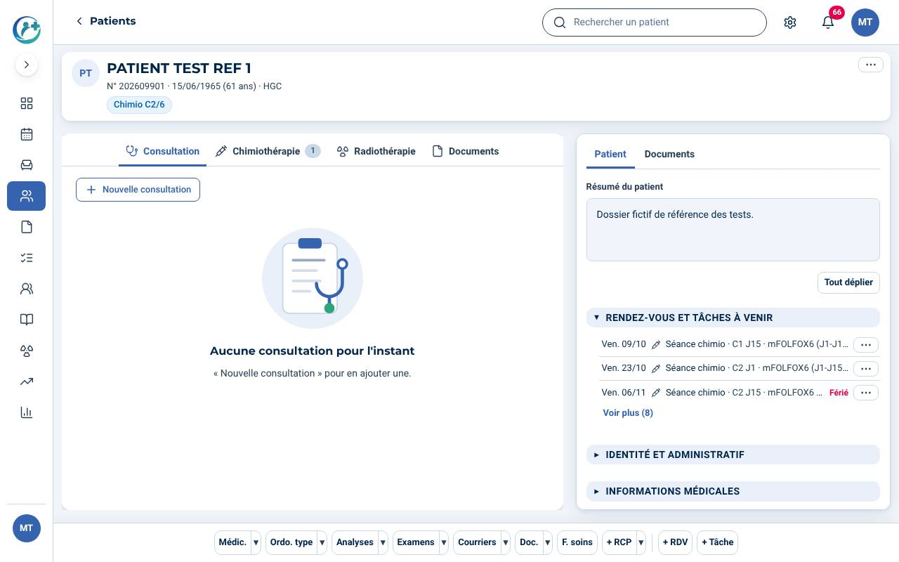
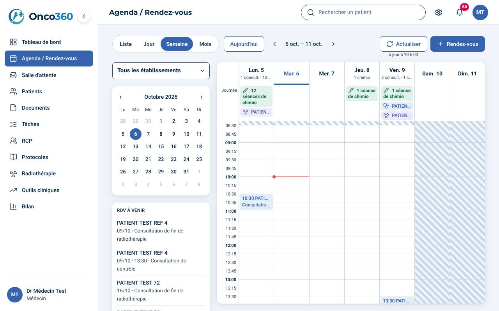
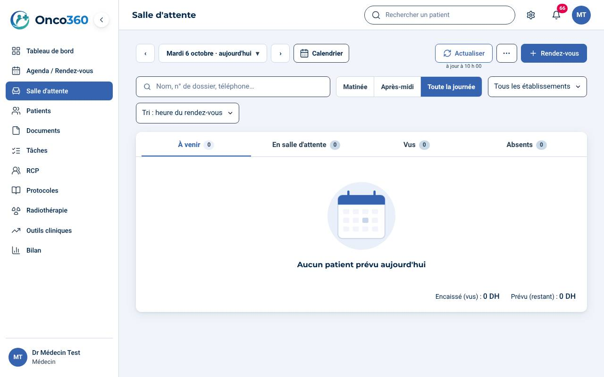
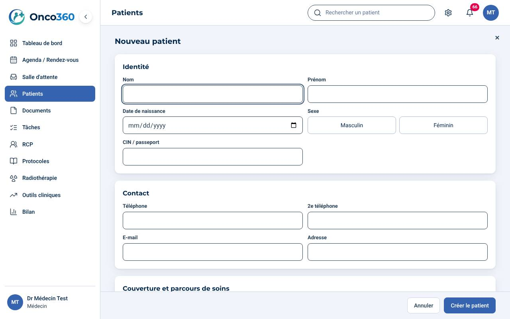

# Onco360 – Guide de démarrage

Quatre pages : deux pour le médecin, deux pour la secrétaire. Les captures viennent d'un cabinet d'essai : tous les patients sont fictifs.
Les guides détaillés de chaque module sont dans le même dossier (dossier patient, ordonnances, salle d'attente, tâches, bilan, en cas de problème).

## Médecin – page 1 : les réglages du premier jour

À faire une fois, dans cet ordre. Comptez trente minutes.

1. **Se connecter.** Adresse : celle donnée par l'éditeur. À la première connexion, lisez et acceptez les conditions générales d'utilisation (case à cocher, puis « Continuer »). Sur un ordinateur partagé, cochez « Poste partagé » avant de vous connecter : la session se ferme avec le navigateur.
2. **Mon compte** (vos initiales, en haut à droite › Mon compte) : nom, INPE, spécialité, photo. Ces informations sont imprimées sur les ordonnances et les reçus.
3. **Paramètres** (la roue en haut à droite) › Cabinet › **Lieux d'exercice** : chaque établissement où vous consultez (nom, adresse, téléphone, mode de paiement habituel).
4. Paramètres › Finances › **Activités et rémunérations** : le prix de chaque type de consultation, de la séance de chimiothérapie, de la radiothérapie, par lieu.
5. Paramètres › Agenda et rappels › **Horaires** : vos jours et heures de consultation ; **Congés et jours fériés**.
6. Paramètres › Cabinet › **Impression** : marges des ordonnances (A5 ou A4) ; imprimez une ordonnance d'essai et ajustez.
7. Mon compte › **Accès** : créez le compte de votre secrétaire (nom, adresse e-mail, rôle). Elle reçoit un e-mail pour choisir son mot de passe ; vous pouvez aussi lui envoyer le lien vous-même par WhatsApp.
8. Paramètres › Agenda et rappels › **Google Agenda** (facultatif) : « Lier mon Google Agenda ». Vos rendez-vous y apparaissent dans un agenda « Onco360 ».
9. Paramètres › Cabinet › **Export des données** : activez l'export automatique de la semaine et reliez le Google Drive du cabinet. Une copie complète part chaque dimanche.
10. **Reprendre vos patients d'un autre logiciel** (facultatif) : même page, « Importer des patients (fichier Excel) ». Téléchargez le modèle, remplissez-le (une ligne par patient), choisissez le fichier : chaque ligne est montrée (prête, doublon, erreur) avant tout import. Le numéro de dossier de l'ancien logiciel est gardé.

## Médecin – page 2 : la journée

1. **Tableau de bord** : la journée (consultations, chimiothérapies, radiothérapies), ce qui attend votre validation, les sept prochains jours.
2. **Ouvrir un dossier** : tapez le nom, la date de naissance ou le numéro dans la recherche en haut.
3. **Consultation** : onglet Consultation › « Nouvelle consultation ». En bas du dossier, la barre des prescriptions : Médic., Ordo. type, Analyses, Examens, Courriers, Doc., F. soins (feuille de soins), + RCP, + RDV, + Tâche.
4. **Chimiothérapie** : onglet Chimiothérapie › nouvelle ligne (protocole de la bibliothèque) ; chaque séance se valide d'un clic, avec le bilan du jour. Les avertissements ne bloquent jamais : vous décidez.
5. **Radiothérapie** : onglet Radiothérapie › prescription, puis les étapes (scanner, contourage, dosimétrie, première séance, fin). Le menu « Radiothérapie » donne le référentiel (schémas, contraintes de dose).
6. **Patient venu** : dans l'agenda ou la salle d'attente, « Valider » = venu ; la fenêtre « Nouveau reçu » propose le prix du lieu, une remise éventuelle en dirhams et le mode de paiement.
7. **Bilan** (menu) : ce qui est dû, payé, à encaisser, par lieu et par période.

Les contenus de référence (protocoles, référentiel de radiothérapie, outils cliniques) sont indicatifs : vérifiez avant toute prescription.

## Secrétaire – page 1 : rendez-vous et accueil

1. **Se connecter** avec l'adresse donnée par le médecin et le mot de passe choisi depuis l'e-mail reçu. Acceptez les conditions générales à la première connexion. Ordinateur partagé : cochez « Poste partagé ».
2. **Nouveau rendez-vous** : bouton « + Rendez-vous » du tableau de bord ou de l'agenda ; choisissez le patient (ou créez-le), le type, le jour et l'heure. Les créneaux déjà pris sont signalés.
3. **Déplacer un rendez-vous** : dans l'agenda, faites-le glisser vers un autre créneau, ou ouvrez-le › Modifier.
4. **Rappels WhatsApp** : le tableau de bord liste les rappels à envoyer ; le message est prêt (français et arabe), vous l'envoyez depuis votre WhatsApp.
5. **Salle d'attente** (menu) : à l'arrivée du patient, « Mettre en salle » ; le médecin voit qu'il est arrivé. Après la consultation, « Valider » (venu) ou « Absent » (proposition de nouvelle date).
6. **Encaisser** : la fenêtre « Nouveau reçu » propose le prix ; choisissez le mode de paiement (espèces, carte, chèque, virement) et imprimez le reçu numéroté.

## Secrétaire – page 2 : dossiers, documents et tâches

1. **Nouveau patient** : bouton « + Patient » ; identité, contact, mutuelle et numéro d'immatriculation. Le numéro de dossier est attribué tout seul.
2. **Déposer un document** (compte rendu, résultat, imagerie) : menu Documents, ou onglet Documents du dossier ; tout est converti en PDF.
3. **Tâches** (menu) : ce que le médecin vous confie, avec une échéance ; cochez « Fait » une fois terminé, ajoutez un commentaire si besoin.
4. **RCP** : Tâches › onglet RCP : les patients inscrits à la prochaine réunion.
5. **Feuille de soins** : bouton « F. soins » du dossier : remplie avec la mutuelle du patient, à imprimer.
6. **En cas de problème** : notez l'heure et ce qui manque, ne ressaisissez rien, prévenez le médecin (Paramètres › Cabinet › Export des données › « En cas de problème »).

Questions : écrivez à l'éditeur d'Onco360 depuis Mon compte › Abonnement, ou par le contact donné à l'ouverture du cabinet.
